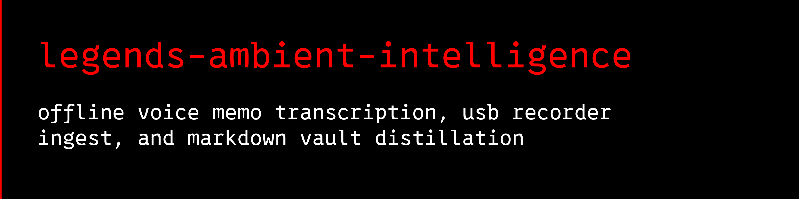
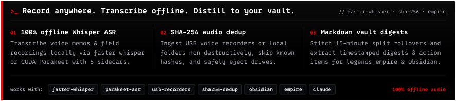
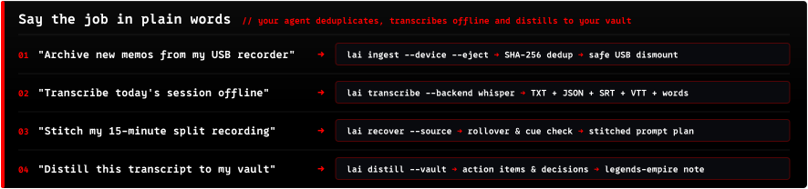
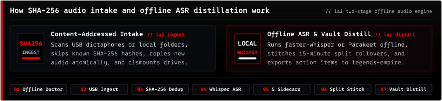
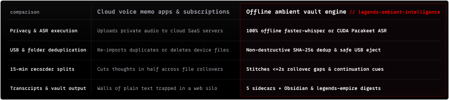

# 

[](https://github.com/avalonreset/legends-ambient-intelligence/releases/latest)
[](https://github.com/avalonreset/legends-ambient-intelligence/actions/workflows/ci.yml)
[](pyproject.toml)
[](pyproject.toml)
[](LICENSE)

**Offline voice-memo and field-recording transcription CLI (`legends-ambient` and `lai`) for coding agents: archive USB voice recorders and local audio folders with non-destructive SHA-256 deduplication, run 100% offline `faster-whisper` or NVIDIA Parakeet ASR, stitch 15-minute recorder rollovers, and distill timestamped Markdown notes and action items into `legends-empire` and Obsidian.**


```text
Install or update legends-ambient-intelligence via cto-legends (https://github.com/avalonreset/cto-legends): run `cto-legends install legends-ambient-intelligence --apply`, then `cto-legends handoff legends-ambient-intelligence` and follow the returned JSON recipe to verify `legends-ambient` (`lai`).
```



## Why `legends-ambient-intelligence` exists

Most voice memo and meeting transcription tools force operators into brittle compromises:

1. **Uploading confidential voice memos and field recordings to cloud SaaS servers:** Sending private founder reflections, customer interviews, or architecture brainstorms to third-party transcription clouds leaks sensitive audio off your machine, hits upload size limits, and traps your transcripts inside a proprietary web dashboard.
2. **Duplicate imports or destructive USB dictaphone syncs:** Plugging in a portable USB voice recorder (such as a KT5000 dictaphone) or pointing a script at a local folder either re-imports the same audio files every week or deletes original recordings off the device before verifying that every byte landed safely on disk.
3. **15-minute hardware recorder split boundaries:** Hardware voice recorders routinely split continuous monologues into fixed 15-minute WAV or MP3 files. Naive transcription pipelines treat each file in isolation, slicing spoken prompts and decisions in half right at the rollover boundary.

`legends-ambient-intelligence` (`legends-ambient` / `lai`) solves the passive offline audio pipeline. While [`legends-hyperyap`](https://github.com/avalonreset/legends-hyperyap) handles live push-to-talk dictation into your active cursor, `legends-ambient-intelligence` ingests saved recordings from USB dictaphones or local folders, deduplicates globally by SHA-256 across all historical archive manifests, runs local `faster-whisper` or NVIDIA NeMo Parakeet ASR 100% offline, recovers thoughts split across 15-minute file boundaries, and distills structured Markdown notes with interactive action-item checkboxes for [`legends-empire`](https://github.com/avalonreset/legends-empire) and Obsidian.

## Ask in plain english

Once [`cto-legends`](https://github.com/avalonreset/cto-legends) is installed, you ask your coding agent in plain english. It previews new audio against your SHA-256 archive ledger, transcribes offline, stitches rollover splits, and writes provenance-linked vault notes:



## Architecture: SHA-256 audio intake and offline ASR distillation



### 1. Content-addressed SHA-256 deduplication and non-destructive USB intake (`lai ingest`)

Every `lai ingest` call treats your source media as read-only evidence:

- **Global SHA-256 deduplication:** Scans a local directory (`--source`) or a mounted USB voice recorder (`--device`), hashes every audio file, and compares each digest against all historical `manifest.json` files in your archive root (`~/.legends-ambient/archive`). Already-archived recordings are skipped automatically.
- **Atomic copy and byte verification:** New recordings are copied into dated session packages (`YYYY/MM/DD/<slug>/`), re-hashed on disk, and indexed in `manifest.json` and `SHA256SUMS.txt` with batch safety bounds (`--max-files 150`, `--max-bytes 2147483648`) and symlink/reparse-point refusal.
- **Native hardware-safe USB dismount (`--eject`):** On Windows, USB volume discovery and ejection use direct Win32 `kernel32` volume APIs (`GetLogicalDrives`, `GetVolumeInformationW`, `GetDriveTypeW == DRIVE_REMOVABLE`, and `DeviceIoControl` `FSCTL_LOCK_VOLUME` / `FSCTL_DISMOUNT_VOLUME` / `IOCTL_STORAGE_EJECT_MEDIA`) without spawning background shells.

### 2. Pluggable 100% offline ASR and 5-format transcript sidecars (`lai transcribe`)

| Surface | `lai` Subcommand | What It Does |
| :--- | :--- | :--- |
| **Readiness & Archive Status** | `doctor`, `status` | Offline diagnostic check (`doctor --offline --json`) across Python 3.11+, archive storage, `ffmpeg`/`ffprobe`, local ASR backends, and USB hardware, plus archive hash inventory (`status`). |
| **Deduplicated Audio Intake** | `ingest` | Dry-run preview (`--what-if`) and non-destructive batch archiving from local folders (`--source`) or USB recorders (`--device --eject`) with SHA-256 manifest verification. |
| **Offline Whisper & Parakeet ASR** | `transcribe` | Local transcription (`--backend whisper` via `faster-whisper` or Whisper CLI, `--backend parakeet` via NVIDIA NeMo, or `--backend mock`) emitting 5 deterministic sidecars (`.txt`, `.json`, `.srt`, `.vtt`, `.words.json`) plus `transcripts/index.md`. |
| **15-Minute Rollover Stitching** | `recover` | Inspects consecutive recordings for boundary timestamp gaps (`<= 2.0s`) and opening continuation cues (`and`, `but`, `because`, `then`, `so`, `or`) to stitch split thoughts across 15-minute recorder rollovers. |
| **Vault Digest & Action Extraction** | `distill` | Extracts spoken action items (`- [ ]`), key decisions, and recurring themes into YAML-frontmatter Markdown notes ready for [`legends-empire`](https://github.com/avalonreset/legends-empire) and Obsidian (`--vault`). |

## Cloud voice memo apps vs `legends-ambient-intelligence`



## Quick start

```sh
# 1. Verify offline readiness across Python, FFmpeg, local ASR engines, and archive storage
legends-ambient doctor --offline --json
legends-ambient status

# 2. Preview new recordings in a local folder or USB voice recorder without copying
legends-ambient ingest --source ./my-recordings --what-if
legends-ambient ingest --device --what-if

# 3. Archive new recordings with SHA-256 deduplication (and safely eject USB media)
legends-ambient ingest --source ./my-recordings --slug afternoon-sketchpad
legends-ambient ingest --device --eject --slug field-notes

# 4. Transcribe an archived session 100% offline into TXT, JSON, SRT, VTT, and words.json
legends-ambient transcribe ~/.legends-ambient/archive/2026/11/21/field-notes --backend whisper --offline

# 5. Check for 15-minute recorder rollover splits and distill into an Obsidian / legends-empire vault
legends-ambient recover --source ./my-recordings --latest-tail 15 --predecessor-tail 5
legends-ambient distill path/to/transcript.json --vault ~/Documents/ObsidianVault/Notes --slug field-notes
```

## Reference

<details>
<summary><strong>Archive package layout, 5-format sidecars, and rollover recovery (<code>lai</code>)</strong></summary>

Every confirmed `legends-ambient ingest` session creates an immutable dated package under `~/.legends-ambient/archive/YYYY/MM/DD/<slug>/` (or the directory passed via `--archive-root` / `LEGENDS_AMBIENT_ARCHIVE_ROOT`):

- **Audio & cryptographic ledger:** Copied audio files alongside `manifest.json` and `SHA256SUMS.txt`.
- **Five transcript sidecars (`transcripts/`):** `<stem>.txt` (clean prose), `<stem>.json` (full segment metadata, duration, language, and model provenance), `<stem>.srt` and `<stem>.vtt` (time-aligned captions), `<stem>.words.json` (word-level timings), and `transcripts/index.md`.
- **Vault distillation (`lai distill`):** Keeps raw transcript sidecars untouched in the archive and exports a clean Markdown note with YAML frontmatter (`source_audio`, `duration_seconds`, `language`, `asr_model`), extracted action items, decisions, and themes.

Read the [agent recipe](docs/AGENT-RECIPE.md) and [search strategy](docs/SEARCH-STRATEGY.md) for complete CLI flags and batch safety bounds.

</details>

<details>
<summary><strong>Agent setup (via <code>cto-legends</code>) and standalone installation</strong></summary>

### Agent setup (via `cto-legends`)

Part of [cto-legends](https://github.com/avalonreset/cto-legends). The central router skill is vendored at [skills/cto-legends/SKILL.md](skills/cto-legends/SKILL.md); this module is not a separate registered skill and does not require an ambient MCP daemon.

Run `cto-legends handoff legends-ambient-intelligence` and read the returned installed recipe and task-readiness checks. If the module is missing, preview setup with `cto-legends install legends-ambient-intelligence`, perform the authorized setup, then repeat the handoff. Use `cto-legends check-updates` to compare your installed version with the catalog and published release. See [docs/AGENT-RECIPE.md](docs/AGENT-RECIPE.md) for the standalone recipe.

```sh
python -m pip install .
# Optional: install with local faster-whisper support
python -m pip install ".[whisper]"
legends-ambient doctor --offline
```

Ensure `ffmpeg` and `ffprobe` are available on your system `PATH` for audio probing and format normalization.

</details>

<details>
<summary><strong>Repository layout, verification, and security guardrails</strong></summary>

```text
Voice Input
  +-- Foreground / Live Cursor Dictation --> legends-hyperyap (push-to-talk)
  +-- Passive / Saved Recordings ----------> legends-ambient-intelligence (lai)
                                               |
                                               v (SHA-256 dedup + offline Whisper + distill)
Knowledge Sink
  +-- Markdown Vault Storage --------------> legends-empire & Obsidian
```

- `src/legends_ambient/`: Console entrypoints (`legends-ambient`, `lai`), SHA-256 deduplicating archiver (`archiver.py`), local and Win32 USB device ingestion (`ingest/`), pluggable Whisper/Parakeet/mock transcription (`transcribe/`), 15-minute rollover recovery and Obsidian vault distillation (`distill/`), and offline readiness diagnostics (`doctor.py`).
- `docs/`: [Agent recipe](docs/AGENT-RECIPE.md) and [search strategy](docs/SEARCH-STRATEGY.md).
- `skills/cto-legends/SKILL.md`: Pinned copy of the central [`cto-legends`](https://github.com/avalonreset/cto-legends) router skill.

```sh
python -m pytest
python scripts/render_cards.py
python scripts/check_release.py
```

All ingestion, transcription, and distillation paths refuse symlinks and NTFS reparse points fail-closed, validate model identifiers against a vetted allowlist unless `--allow-custom-model` is passed, and never delete or modify source files on USB recorders or local directories.

</details>

## Contributing, security, and license

See [CONTRIBUTING.md](CONTRIBUTING.md), [SUPPORT.md](SUPPORT.md), and [SECURITY.md](SECURITY.md).

MIT License. See [LICENSE](LICENSE) and [THIRD_PARTY_NOTICES.md](THIRD_PARTY_NOTICES.md). Copyright (c) 2026 Avalon Reset.

[](https://github.com/avalonreset/cto-legends/issues/new?title=Message%20for%20Avalon%20Reset&labels=message)

<p align="center"><a href="https://github.com/stars/avalonreset/lists/cto-legends"></a></p>

**Specification & benchmarks on cto-legends.com:**
- **Module specification & architecture matrix:** [cto-legends.com/modules/legends-ambient-intelligence](https://cto-legends.com/modules/legends-ambient-intelligence)
- **Related engineering dispatches:** [Obsidian Second Brain: Markdown Knowledge Base Guide](https://cto-legends.com/blog?post=obsidian-second-brain-markdown-knowledge-base) · [How to Build AI Agents: Production CLI & MCP Routing](https://cto-legends.com/blog?post=how-to-build-ai-agents-cli-mcp-routing)
- **Ecosystem hub:** [cto-legends.com/home](https://cto-legends.com/home)
