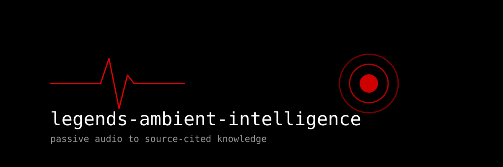

# 

**Ambient audio capture, deduplicated archiving, offline transcription, and knowledge distillation for the Legends ecosystem.**

[](https://github.com/avalonreset/legends-ambient-intelligence/releases/latest)
[](https://github.com/avalonreset/legends-ambient-intelligence/actions/workflows/ci.yml)
[](LICENSE)
[](https://www.python.org/)
[](https://cto-legends.com)

Turn continuous background recording and voice sketchpads into structured, source-cited knowledge notes.

---

## What it is

Most voice tools focus on real-time typing at your keyboard. **Legends Ambient Intelligence** solves the passive audio pipeline:

1. **Dual input capture:** Ingest audio recorded directly from your computer microphone, laptop folders, or dedicated portable USB voice recorders (such as the KT5000 or generic dictaphones).
2. **Non-destructive deduplication:** Scans incoming files, computes SHA-256 checksums, and compares against historical manifests. Files are safely archived into dated packages without deleting source media.
3. **Hardware-safe ejection:** When ingesting from removable USB media, dismounts the volume cleanly so the recorder can be safely unplugged.
4. **Pluggable offline ASR:** Transcribe using local Whisper (`faster-whisper` or CLI) or NVIDIA NeMo Parakeet for high-throughput GPU rigs. Produces TXT, JSON, SRT, VTT, and word-level timestamps.
5. **Prompt continuation recovery:** Detects 15-minute file split boundaries and mid-thought continuation words (`and`, `but`, `because`, `then`), stitching preceding context into clean prompt clips.
6. **Obsidian distillation:** Extracts action items, decisions, and recurring themes into markdown notes with full audio provenance for your knowledge vault.

---

## Where it fits in the Legends ecosystem

```text
[ Voice Input ]
  +-- Foreground / Live Typing --> hyperyap (direct keyboard dictation)
  +-- Background / Ambient Audio --> legends-ambient-intelligence
                                        |
                                        v (deduplicate + transcribe + distill)
[ Knowledge Sink ]
  +-- Markdown Vault Storage ------> legends-empire (source-cited memory)
```

- **hyperyap:** Real-time voice typing and dictation into active applications.
- **legends-ambient-intelligence:** Passive ambient recording, background batch ingestion, and concept distillation.
- **legends-empire:** Structured vault storage, research citations, and agent memory.
- **cto-legends:** Ecosystem router and manager to discover and install all tools.

---

## Installation

Requires Python 3.10 or newer. Standard audio tools (`ffmpeg` and `ffprobe`) should be installed on your system PATH.

```sh
# Clone repository
git clone https://github.com/avalonreset/legends-ambient-intelligence.git
cd legends-ambient-intelligence

# Install core CLI and tools
python -m pip install .

# Optional: install with local Whisper support
python -m pip install ".[whisper]"
```

Verify your installation:

```sh
legends-ambient doctor
```

---

## Quickstart

### 1. Ingest audio files from a local mic folder

Record audio using your computer microphone, voice memo app, or drop files into a folder:

```sh
# Preview what would be archived
legends-ambient ingest --source ./my-recordings --what-if

# Archive new recordings safely
legends-ambient ingest --source ./my-recordings --slug afternoon-sketchpad
```

### 2. Ingest from a hardware USB recorder

Connect your USB voice recorder:

```sh
# Auto-detects device volume, archives new files, and safely dismounts
legends-ambient ingest --device --eject --slug daily-notes
```

### 3. Transcribe an archived session

Run local ASR to produce TXT, JSON, SRT, VTT, and word timing sidecars:

```sh
legends-ambient transcribe ~/.legends-ambient/archive/2026/09/24/daily-notes --backend whisper
```

### 4. Recover lost prompt continuity

When speaking continuous thoughts across file rollover limits, inspect the continuation plan:

```sh
legends-ambient recover --source ./my-recordings --latest-tail 15 --predecessor-tail 5
```

### 5. Distill transcript into an Obsidian vault note

Extract action items, core takeaways, and metadata into a formatted note:

```sh
legends-ambient distill path/to/transcript.json --vault ~/Documents/ObsidianVault/Notes
```

---

## Agent setup (via `cto-legends`)

Part of the [CTO Legends](https://github.com/avalonreset/cto-legends) ecosystem. `cto-legends` is the only registered skill; this repo vendors a pinned copy at `skills/cto-legends/SKILL.md`.

Install with `cto-legends install legends-ambient-intelligence`, then follow the module recipe the router loads. Do not register this module as its own skill.

---

## License

MIT License. See [LICENSE](LICENSE) for details.
